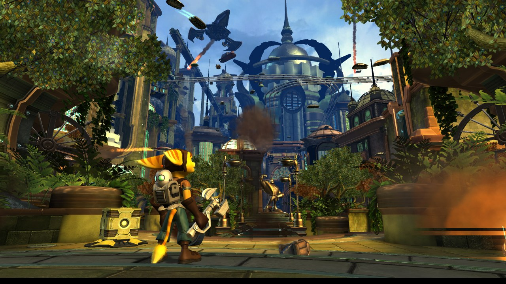
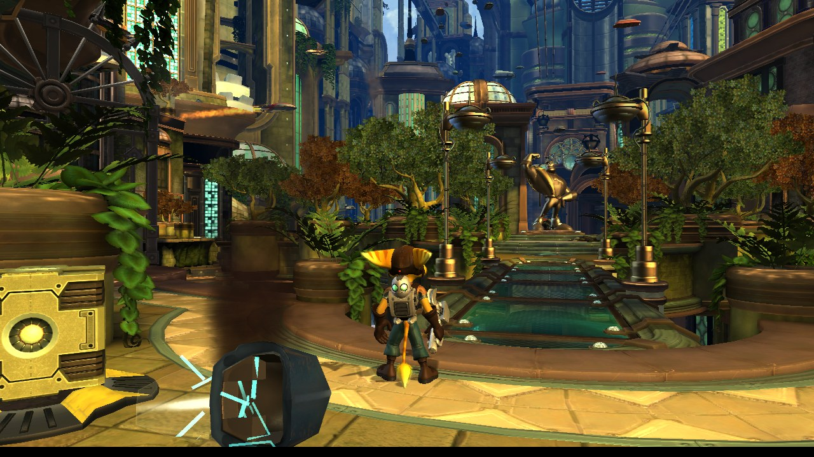
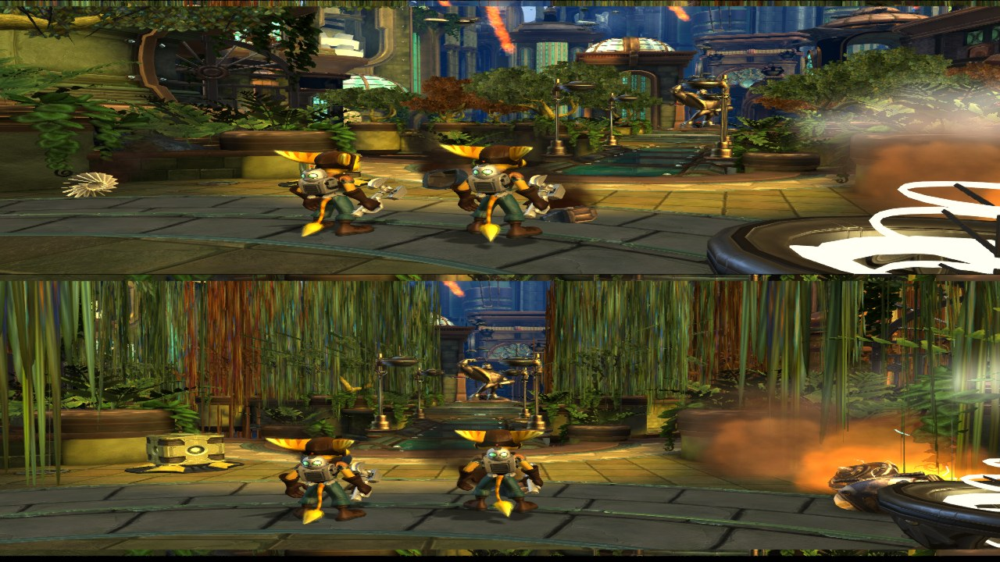
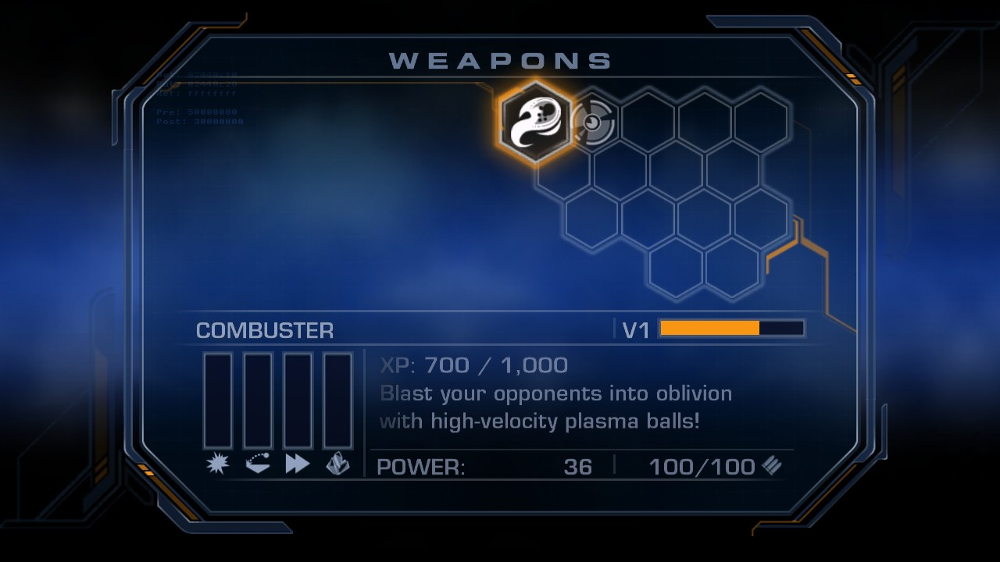

<p align="center">
  
</p>

<h1 align="center">Ratchet Retooled</h1>

<p align="center">
  A native PC port of <b>Ratchet &amp; Clank Future: Tools of Destruction</b>, made by static recompilation.<br>
  Windows and Linux &middot; Vulkan &middot; up to 4x resolution &middot; high frame rates &middot; split-screen co-op
</p>

<p align="center">
  <a href="https://jackypendrag0n.github.io/ratchet-retooled/">Website</a> &middot;
  <a href="#install">Install</a> &middot;
  <a href="#features">Features</a> &middot;
  <a href="docs/TECHNICAL.md">How it works</a>
</p>

---

Ratchet Retooled translates the game's PS3 code (PowerPC and SPU) into C++ ahead of time and compiles it into a
normal PC program, with a small runtime that stands in for the PS3's system libraries and a Vulkan renderer for its
graphics chip. There is no emulator inside and no JIT.

> [!IMPORTANT]
> **This repository contains no game code and no game files.** To play, you need your own copy of the game
> (the North American disc, BCUS98127, v2.00), dumped from your own disc. The build turns *your* copy's program
> into C++ on your own computer. Never share that generated code, the decrypted EBOOT, or any game files.

## Features

| | |
|---|---|
| **Runs natively** | Windows 10/11 and Linux (x86-64), with a Vulkan 1.3 GPU. macOS builds are experimental and untested. |
| **Sharper picture** | Resolution scale 1x to 4x (supersampling), FXAA, anisotropic filtering up to 16x, soft shadows. |
| **High frame rate** | 30 fps like the PS3, the game's own 60 fps mode, or any cap up to 240 fps (or uncapped). |
| **Widescreen** | 16:9, 21:9 and 32:9. |
| **Two-player co-op** *(experimental)* | A second Ratchet on a second controller, split screen, with shared weapons, bolts and XP. |
| **Cheat and debug menu** | F1 or L3+R3: god mode, infinite ammo, all weapons and upgrades, bolts and raritanium, level warp, no clip, free camera, photo mode, slow motion, save/restore position, speedometer. |
| **Weapon XP** | The pause menu's weapons page shows each weapon's exact XP and what the next level needs. |
| **Saves** | Normal in-game saving, stored as plain folders next to the program (same layout as RPCS3, so you can carry saves over). |
| **Controls** | Keyboard, or any SDL2 gamepad (Xbox, DualShock, DualSense, ...) with rumble. |
| **Mods** | Texture packs (dump, edit, replace), a mods folder that overrides any game file, model tools for Blender. |
| **Quality of life** | Skip the logo movies, skip in-engine cutscenes with Start, background shader building so the game doesn't stall. |

## Screenshots

| | |
|---|---|
|  |  |
| Kerwan with soft shadows | Split-screen co-op |
|  |  |
| Weapon XP on the weapons page | 2x supersampling |

## Install

There are no ready-made downloads. A built program contains the game's own code, so everyone builds their own
from their own copy of the game. It takes three steps and around 15 minutes, most of it waiting for the compiler.

### Step 1: Dump your game

You need two things from your own disc.

1. **The game folder.** Dump your disc with a PS3 running custom firmware (multiMAN, webMAN MOD, IRISMAN), or
   with a compatible Blu-ray drive and [ps3-disc-dumper](https://github.com/13xforever/ps3-disc-dumper).
   You end up with a folder that contains `PS3_GAME` (and `PS3_DISC.SFB`).
   - Have a **decrypted ISO** of your disc instead? Extract it with 7-Zip (Windows: right-click > 7-Zip >
     Extract; Linux: `7z x game.iso -ogame`, or mount it and copy everything out).
2. **A decrypted `EBOOT.elf`.** `PS3_GAME/USRDIR/EBOOT.BIN` is encrypted. Open [RPCS3](https://rpcs3.net),
   choose *Utilities > Decrypt PS3 Binaries*, pick `EBOOT.BIN`, and save the result as `EBOOT.elf` in the same
   folder.

   It must be the **v2.00 disc EBOOT** (the disc's `PARAM.SFO` says `VERSION 02.00`). The v1.00 disc and
   game updates have different EBOOTs and will not work. Check it:
   10,923,400 bytes, SHA-256 `0ee9a8414c8fc182bc19fa2a523e6d050d0be76138b3733ae515798d77d2468c`.

You don't need to install the game in RPCS3. Your folder should look like this:

```
My TOD folder/
  PS3_GAME/
    USRDIR/
      EBOOT.BIN
      EBOOT.elf      <- you made this
      packed/ ...
```

### Step 2 (Windows): Build

Building on Windows uses [MSYS2](https://www.msys2.org), a free set of compiler tools. (Visual Studio's compiler
is not supported.)

1. Install MSYS2 from [msys2.org](https://www.msys2.org) and keep the default folder `C:\msys64`.
2. Open **MSYS2 UCRT64** from the Start menu. All the commands below go in that window.
3. Install the tools and libraries:
   ```bash
   pacman -S --needed git python mingw-w64-ucrt-x86_64-gcc mingw-w64-ucrt-x86_64-cmake mingw-w64-ucrt-x86_64-ninja \
     mingw-w64-ucrt-x86_64-SDL2 mingw-w64-ucrt-x86_64-vulkan-headers mingw-w64-ucrt-x86_64-vulkan-loader \
     mingw-w64-ucrt-x86_64-shaderc mingw-w64-ucrt-x86_64-zlib
   ```
4. Download the source and go into it:
   ```bash
   git clone https://github.com/JackyPendrag0n/ratchet-retooled.git
   cd ratchet-retooled
   ```
5. Generate C++ from **your** EBOOT. Windows drive letters are written `/c/...` here, so
   `C:\Games\My TOD folder` becomes `/c/Games/My TOD folder`:
   ```bash
   python ppu_codegen.py "/c/Games/My TOD folder/PS3_GAME/USRDIR/EBOOT.elf" gen
   python spu_codegen.py "/c/Games/My TOD folder/PS3_GAME/USRDIR/EBOOT.elf" gen_spu
   ```
6. Build (5 to 15 minutes; if your PC runs out of memory, add `-j 2` to the second line):
   ```bash
   cmake -S . -B build -G Ninja
   cmake --build build
   ```
7. Copy the DLLs the game needs next to it, so it also runs outside MSYS2:
   ```bash
   ldd build/tod.exe | grep -i ucrt64 | awk '{print $3}' | xargs -I{} cp {} build/
   ```

Your game is `build\tod.exe` (inside `C:\msys64\home\<your name>\ratchet-retooled`). Copy `tod.exe` and all the
`.dll` files from `build` into the folder **next to** your `My TOD folder`, and double-click `tod.exe`. Your graphics
driver provides Vulkan already.

### Step 2 (Linux): Build

Install the build tools for your distribution:

```bash
# Ubuntu / Debian / Mint / Pop!_OS
sudo apt install git cmake ninja-build g++ python3 libsdl2-dev libvulkan-dev libshaderc-dev zlib1g-dev
# Fedora
sudo dnf install git cmake ninja-build gcc-c++ python3 SDL2-devel vulkan-loader-devel libshaderc-devel zlib-devel
# Arch / Manjaro / SteamOS (desktop mode)
sudo pacman -S git cmake ninja gcc python sdl2 vulkan-icd-loader vulkan-headers shaderc zlib
```

Then get the source, generate C++ from **your** EBOOT, and build (you need GCC 13+ or Clang 16+):

```bash
git clone https://github.com/JackyPendrag0n/ratchet-retooled.git
cd ratchet-retooled
python3 ppu_codegen.py "/path/to/My TOD folder/PS3_GAME/USRDIR/EBOOT.elf" gen
python3 spu_codegen.py "/path/to/My TOD folder/PS3_GAME/USRDIR/EBOOT.elf" gen_spu
cmake -S . -B build -G Ninja
cmake --build build          # add -j 2 if you run out of memory
```

Your game is `build/tod`. (`packaging/AppRun` is a launcher script if you want to wrap it in an AppImage for
yourself.)

### Step 3: Play

The easiest way: put `tod` / `tod.exe` (with its DLLs on Windows) **next to** your game folder and start it. It
finds the folder that holds `PS3_GAME/USRDIR/EBOOT.elf` by itself:

```
Games/
  My TOD folder/      <- PS3_GAME is in here
  tod.exe             <- plus the .dll files on Windows
  tod-data/           <- created on first run: settings.ini, caches, the log
  TOD Saves/          <- created on first run: your saves
```

Or point it at everything yourself:

```bash
tod "/path/to/PS3_GAME/USRDIR/EBOOT.elf" --game "/path/to/My TOD folder" --data ./tod-data
```

| option | |
|---|---|
| `--game <dir>` | the folder that contains `PS3_GAME` |
| `--data <dir>` | settings, caches and installs (default `tod-data`) |
| `--saves <dir>` | save folder |
| `--no-vsync` | don't wait for the monitor's refresh |
| `-v`, `-q` | more or less logging |
| `-- <args>` | passed to the game itself, e.g. `-- -no_movies` |

On Windows the log is written to `tod-data/tod.log`; if the game stops, a message box tells you where it is.

## Playing

### Controls

| keyboard | PS3 |
|---|---|
| W A S D | left stick |
| I J K L | right stick |
| arrow keys | D-pad |
| Space / C / F / R | Cross / Circle / Square / Triangle |
| Q / E | L1 / R1 |
| 1 / 3 | L2 / R2 |
| Enter / Tab | Start / Select |
| F1 (L3+R3 on a pad) | cheat, debug and settings menu |
| F11 / F12 | fullscreen / screenshot |
| F2 / F4 | slow motion / photo mode |
| F5 / F9 | save position / go back to it |

Gamepads just work, with rumble. Start skips in-engine cutscenes.

### Settings

`tod-data/settings.ini` is created on the first run and explains every option. Most of them can also be changed
live in the F1 menu's **Graphics** tab.

| setting | what it does |
|---|---|
| `framerate` | `30` (like the PS3), `60`, any cap up to `240`, or `0` for no cap |
| `vsync` | `false` to go past your monitor's refresh rate |
| `resolution_scale` | `1` to `4` times 1280x720 |
| `antialiasing` | `fxaa` or `off` |
| `anisotropic_filtering` | `0`, `2`, `4`, `8` or `16` |
| `soft_shadows` | smoother shadow edges |
| `aspect` | `16:9`, `21:9` or `32:9` |
| `skip_intro` | skip the logo movies and legal screens |
| `rumble` | controller rumble strength, 0 to 100 |
| `coop` | two-player split screen |
| `weapon_xp` | XP numbers on the weapons page |
| `cheat_menu` | allow the F1 menu |
| `save_folder` | where your saves go |

### Co-op (experimental)

Tick **Two players, split screen** in F1 > Fun, or set `coop = true`. The second controller is player 2 (with
only one controller, the keyboard is player 1). The screen splits once a level has started. Weapons, ammo,
bolts and XP are shared; you can't both hold the same weapon. **D-pad Down** teleports you to your partner.

Still rough: co-op can crash when player 2 respawns, and cutscenes and vehicles only know about player 1.

### Cheat and debug menu

Press **F1** (or L3+R3 on a controller):

- **Player:** god mode, infinite ammo, no clip, free camera, remove Clank, bolts.
- **Weapons:** give any weapon at any level, give everything, raritanium and every weapon mod.
- **Fun:** co-op, weapon XP display, the Gelanator mod, the game's own unlockable cheats, game speed, photo
  mode, practice tools (save/restore position, speedometer).
- **Level warp:** jump to any planet.
- **Graphics:** everything in the settings table above, live.

### Saves

The game saves normally. Each save is a `BCUS98127_SAVE_<n>` folder in `TOD Saves` next to the program (or
wherever `save_folder` points). That is the same layout RPCS3 uses, so you can copy saves from RPCS3's
`dev_hdd0/home/00000001/savedata` folder into it and back.

### Mods

- **Texture packs:** turn on *Save textures the game draws* in F1 > Graphics (or `texture_dump = true`). Edit
  a PNG from `tod-data/textures/dump` and put it in `tod-data/textures`, keeping the hash at the start of its
  name. It replaces that texture in the game.
- **Replacing game files:** a file at `tod-data/mods/<path under PS3_GAME>` is read instead of the game's own.
- **Models:** `tools/modding/tod_model.py` exports characters and objects to glTF for Blender and imports edited
  ones. See [docs/model_formats.md](docs/model_formats.md).

Please only share mods made of your own work, and never share files taken from the game.

## Known issues

- Co-op is experimental (see above).
- macOS is untested. It needs an Intel build under Rosetta 2 and MoltenVK; see
  [docs/TECHNICAL.md](docs/TECHNICAL.md).
- Only the North American v2.00 disc (BCUS98127) is supported. The v1.00 disc has a different EBOOT, and the
  recompiled code is tied to the exact EBOOT it was generated from.

## How it works

- `ppu_codegen.py` analyses the whole PowerPC program (about 24,000 functions, 2.1 million instructions) and
  writes one C++ function per game function.
- `spu_codegen.py` does the same for the code that ran on the PS3's SPU co-processors.
- `runtime/` and `host/` stand in for the PS3: the lv2 kernel, system libraries, audio, file system, saves,
  the RSX graphics chip (drawn with Vulkan), input, and the menu overlay.

[docs/TECHNICAL.md](docs/TECHNICAL.md) has the details, debug switches and environment variables.

| path | |
|---|---|
| `ppu_codegen.py`, `tools/ppu_funcs.py` | PPU recompiler |
| `spu_codegen.py`, `tools/spu_isa.py`, `spu_entries.txt` | SPU recompiler |
| `runtime/` | guest CPU state, memory, dispatch, the small OS layer |
| `host/` | system emulation, RSX and Vulkan renderer, window and input, cheats, co-op, weapon XP |
| `harness/` | a boot test |
| `tools/modding/` | archive, model and texture tools |
| `third_party/imgui` | [Dear ImGui](https://github.com/ocornut/imgui) (MIT) for the overlay menu |

## Legal

This repository is original code: a recompiler, a runtime and tools. It contains no part of the game and must
not be used to distribute any: no EBOOT (encrypted or decrypted), no generated code, no archives, textures,
models, audio or video. Use it only with a copy of the game you own.

Ratchet Retooled is a fan project. It is not affiliated with or endorsed by Sony Interactive Entertainment or
Insomniac Games. "Ratchet & Clank" is a trademark of Sony Interactive Entertainment LLC.
